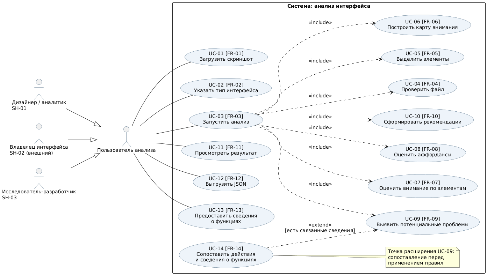

# Лабораторная работа № 1. Формулирование требований к программной системе

| Поле | Значение |
|---|---|
| Студент | Киров Дмитрий Владимирович |
| Группа | РИС-23-3 |
| Вариант | Индивидуальная постановка на основе темы ВКР |
| Постановка задачи | [README репозитория](../../README.md) |
| Репозиторий | https://github.com/Allabari47/software-architecture-labs |
| Дата подготовки | 17.11.2026 |
| Срок сдачи по заданию | 06.12.2026 |

**Тема:** анализ предметной области и формулирование требований к программной системе.

**Цель:** проанализировать задачу, выделить заинтересованных лиц, сформулировать функциональные и нефункциональные требования и представить взаимодействие пользователей с системой на диаграмме вариантов использования.

## Краткое описание системы

Проектируется система анализа пользовательских интерфейсов по скриншотам. Пользователь получает прогнозную карту внимания, разметку элементов и оценки действий, которые предполагает их внешний вид. При наличии дополнительных сведений система сопоставляет воспринимаемые действия с описанными функциями элементов, выявляет потенциальные проблемы по правилам и формирует рекомендации. Приложение предназначено для дизайнеров, аналитиков и владельцев интерфейсов; исследователь-разработчик подготавливает данные, модели и правила анализа. Прогноз внимания и аффордансов характеризует предполагаемое восприятие интерфейса; эффективность рекомендованных изменений оценивается при проверке интерфейса с пользователями.

## Оглавление

1. [Заинтересованные лица](#1-заинтересованные-лица)
2. [Функциональные требования](#2-функциональные-требования)
3. [Диаграмма вариантов использования](#3-диаграмма-вариантов-использования)
4. [Нефункциональные требования](#4-нефункциональные-требования)
5. [Предположения](#5-предположения)

## 1. Заинтересованные лица

Выделены три группы заинтересованных лиц. Дизайнер и владелец интерфейса используют функции анализа. Исследователь-разработчик также взаимодействует с подсистемой подготовки моделей и правил.

| ID | Стейкхолдер | Роль | Интересы / цели | Влияние и обоснование |
|---|---|---|---|---|
| SH-01 | UX/UI-дизайнер или аналитик | Основной пользователь | Находить потенциально незаметные или неоднозначные элементы; получать объяснимые предложения по их изменению | Высокое: определяет требования к анализу и представлению результатов |
| SH-02 | Владелец анализируемого интерфейса, внешний по отношению к разработчику системы | Пользователь результатов, принимающий решение о доработке | Сопоставлять рекомендации с назначением элементов; выбирать изменения для проверки | Высокое: предоставляет сведения о своём интерфейсе и принимает решения о его изменении |
| SH-03 | Исследователь-разработчик | Пользователь анализа и подсистемы подготовки моделей | Подготавливать и оценивать модели; управлять воспроизводимыми конфигурациями правил | Высокое: определяет условия применимости моделей и критерии формирования рекомендаций |

## 2. Функциональные требования

Требования охватывают анализ интерфейса и подготовку моделей. Приоритет Must обозначает обязательную функцию системы, Should обозначает желательную функцию, отсутствие которой не препятствует основному сценарию анализа.

| ID | Требование | Стейкхолдер | Приоритет | Обоснование |
|---|---|---|---|---|
| FR-01 | Пользователь может загрузить скриншот интерфейса в формате PNG или JPEG | SH-01, SH-02, SH-03 | Must | Скриншот служит обязательным входом анализа |
| FR-02 | Пользователь может задать тип интерфейса: веб, десктопный или мобильный | SH-01, SH-02, SH-03 | Must | Тип интерфейса по изображению не всегда определяется однозначно |
| FR-03 | Пользователь может запустить анализ скриншота с выбранным типом интерфейса и получить идентификатор запроса для проверки его состояния | SH-01, SH-02, SH-03 | Must | Обеспечивает запуск и отслеживание длительной обработки |
| FR-04 | Система должна проверять декодируемость и фактический формат скриншота, объём входных данных и число пикселей по опубликованным лимитам конфигурации; при отказе сообщать нарушенное условие | SH-01, SH-02, SH-03 | Must | Защищает обработчик от некорректного или чрезмерного входа |
| FR-05 | Система должна формировать список найденных UI-элементов с уникальным в пределах анализа ID и прямоугольными границами в координатах исходного скриншота | SH-01, SH-03 | Must | Связывает результаты анализа с элементами |
| FR-06 | Система должна строить прогнозную карту зрительного внимания, пространственно совмещённую с исходным скриншотом | SH-01, SH-02, SH-03 | Must | Показывает предполагаемое распределение внимания |
| FR-07 | Система должна рассчитывать для каждого выделенного элемента долю прогнозируемого внимания как сумму нормированной карты внутри его границ | SH-01, SH-03 | Must | Позволяет сопоставлять внимание с элементами |
| FR-08 | Система должна оценивать для каждого элемента множество воспринимаемых действий из набора click, input, scroll, drag с оценкой уверенности по каждому действию и отдельным статусом определённости результата | SH-01, SH-03 | Must | Учитывает возможность нескольких действий и ограниченную уверенность прогноза |
| FR-09 | Система должна выявлять потенциальные проблемы по версионируемым правилам, указывая ID правила, элементы, входные значения и условия срабатывания; при недостаточных данных отмечать правило как неприменимое с указанием причины | SH-01, SH-02, SH-03 | Must | Позволяет проверить основание каждого замечания |
| FR-10 | Система должна для каждой выявленной проблемы формировать рекомендацию с предлагаемым изменением и пояснением его связи с проблемой | SH-01, SH-02 | Must | Даёт пользователю обоснованный вариант доработки |
| FR-11 | Пользователь может просмотреть отчёт с исходным скриншотом, тепловой картой, границами элементов, оценками действий и внимания, результатами сопоставления функций, замечаниями и рекомендациями | SH-01, SH-02, SH-03 | Must | Обеспечивает доступ к результатам и ограничениям анализа |
| FR-12 | Пользователь может выгрузить завершённый отчёт в JSON с данными элементов, результатами проверок и идентификаторами конфигурации анализа | SH-02, SH-03 | Should | Позволяет передавать и повторно обрабатывать результаты |
| FR-13 | Пользователь может предоставить дополнительные сведения о функциях элементов в виде структурированного описания с привязкой к области скриншота, источником сведений и статусом проверки поведения | SH-01, SH-02, SH-03 | Must | Позволяет учитывать назначение элементов, недоступное из изображения |
| FR-14 | Система должна сопоставлять воспринимаемые действия с дополнительными сведениями только для однозначно связанных элементов и показывать различия с учётом полноты и статуса подтверждения сведений | SH-01, SH-02, SH-03 | Must | Разделяет визуальный прогноз, описание функции и проверенное поведение |
| FR-15 | Система должна подготавливать версионируемый набор данных для обучения с проверкой рамок и разметки действий, подготовкой карт внимания и фиксацией разбиения train/validation/test | SH-03 | Must | Задаёт воспроизводимые входы обучения и оценки |
| FR-16 | Система должна выполнять обучение моделей внимания и аффордансов по выбранной конфигурации, используя train для оптимизации и validation для выбора параметров, и сохранять журнал запусков | SH-03 | Must | Обеспечивает управляемый процесс настройки моделей |
| FR-17 | Система должна формировать протокол итоговой оценки зафиксированной модели на test с указанием версии данных, метрик, размера выборки и результатов по типам интерфейсов. Для модели аффордансов протокол также содержит результаты по каждому действию | SH-03 | Must | Обеспечивает отдельную оценку обобщающей способности |
| FR-18 | Система должна сохранять выбранную модель в хранилище под уникальной версией вместе с весами, версией данных, конфигурацией предобработки, условиями применимости и ссылкой на протокол оценки. В комплект модели аффордансов также входит словарь действий | SH-03 | Must | Позволяет использовать в анализе идентифицируемый комплект модели |
| FR-19 | Пользователь подсистемы подготовки моделей может сохранять версию правил рекомендаций с условиями применимости, порогами, текстами рекомендаций и результатами проверки на контрольных примерах | SH-03 | Must | Делает критерии анализа явными и проверяемыми |

### Уточнения к требованиям

В FR-07 карта содержит неотрицательные значения и нормируется так, чтобы сумма по изображению равнялась 1. Оценка элемента равна сумме значений в его прямоугольнике. При пересечении прямоугольников одни пиксели участвуют в нескольких оценках, поэтому сумма оценок элементов может превышать 1. Нулевая сумма исходной карты считается ошибкой результата модели; система не подменяет её достоверным прогнозом.

В FR-08 click означает нажатие, input ввод, scroll прокрутку, drag перетаскивание. Например, поле ввода может восприниматься одновременно как нажимаемое и допускающее ввод. Для результата с достаточной определённостью пустое множество действий обозначается none. Статус unclear означает, что надёжно определить набор действий нельзя; он не заменяет none и не является действием. Оценки уверенности являются выходами модели и без отдельной калибровки не трактуются как вероятности правильного ответа. Дополнительные сведения о функциях не изменяют визуальный прогноз: результаты хранятся раздельно.

В FR-13 описание содержит координаты области, допустимые действия, текст функции и источник: описание пользователя, фрагмент DOM, дерево Accessibility или исходный код. Статус поведения задаётся как «не проверено» или «проверено пользователем»; для второго указываются способ и условия проверки. Для списка действий отмечается, является ли он полным. Значимость элемента для задачи может задаваться дополнительно. Фрагменты кода принимаются как текст и не исполняются. До запуска анализа пользователь отмечает область на исходном скриншоте. После детекции система показывает найденные рамки для этой области. Пользователь может подтвердить одну рамку или пропустить привязку. В сравнении участвуют только подтверждённые пары «описание — элемент». Отсутствие дополнительных сведений не препятствует анализу скриншота.

В FR-14 при неполном описании отсутствие действия в описании не считается свидетельством невозможности действия. Результат сопоставления содержит общий набор действий, различия и основание сравнения. DOM и Accessibility дают сведения о структуре и заявленных свойствах; отметка проверки поведения указывается вместе с её источником и не означает независимой проверки системой.

Для FR-09 применяются правила двух типов:

| ID | Условие применимости | Потенциальная проблема | Основание рекомендации |
|---|---|---|---|
| R-01 | Заданы значимость элемента для задачи, группа сравнения и порог внимания в конфигурации правила; доступны пригодные оценки внимания | Недостаточное прогнозируемое внимание к значимому элементу по выбранному критерию | Проверить визуальное выделение и положение элемента в контексте задачи |
| R-02 | Дополнительные сведения однозначно связаны с элементом; определённость визуального прогноза достаточна для сравнения | Расхождение воспринимаемых действий с описанными функциями элемента | Проверить соответствие визуальных признаков заявленному действию; статус проверки поведения включается в формулировку замечания |

В R-01 пригодной считается конечная неотрицательная карта с ненулевой суммой. Критерий сравнения, состав группы элементов и порог должны быть заданы в конфигурации правила; без любого из этих параметров проверка неприменима.

Низкая оценка внимания без сведений о значимости элемента сама по себе не порождает замечание R-01. Статус unclear отражается в отчёте как ограничение анализа; он не считается проблемой юзабилити и блокирует зависимые выводы R-02. Если данных для правила недостаточно, в отчёте указывается «не проверено» с причиной. Отсутствие срабатываний означает только отсутствие замечаний по применимым правилам.

В FR-15 проверяются допустимость многометочной разметки, связь рамок с изображениями и отсутствие общих исходных интерфейсов между выборками, включая их производные изображения. Пустой набор с none и неопределённая разметка unclear учитываются раздельно. Идентификаторы исходных интерфейсов, критерии группировки и исключённые записи сохраняются в версии набора.

В FR-17 для внимания рассчитываются CC, KL, NSS и SIM, для многометочных аффордансов precision, recall и F1 по действиям и macro-F1; отдельно указываются доля определённых прогнозов и качество на них. Классы без примеров обозначаются как неоцениваемые. Порог отказа от прогноза выбирается на validation. Итоговая оценка проводится после фиксации конфигурации; все обращения к test регистрируются и не используются для настройки той же модели. Протокол сохраняет определения метрик, правила обработки пустых карт и версии расчётного кода.

### Проверка функциональных требований

Для каждого требования предусматривается приёмочная проверка:

| Требования | Проверка и ожидаемый результат |
|---|---|
| FR-01–FR-04 | Допустимые PNG/JPEG и каждый тип интерфейса принимаются; повреждённые файлы и входы сверх опубликованных лимитов отклоняются с причиной. Для принятой задачи доступны идентификатор и состояния «принята», «выполняется», «завершена» или «ошибка» |
| FR-05–FR-07 | На контрольных изображениях рамки лежат в границах исходника, ID уникальны, карта совмещена с изображением. На синтетической нормированной карте сумма по заданной рамке совпадает с ожидаемой с абсолютной погрешностью не более 10⁻⁶; нулевая сумма карты вызывает диагностическое сообщение |
| FR-08 | Проверены отдельные действия, сочетание click/input, none и unclear. none не совмещается с действиями; unclear не выводится как уверенное отсутствие действий |
| FR-09–FR-10 | Для каждого правила проверены срабатывание, отсутствие срабатывания и неприменимость. Каждое замечание содержит основание и рекомендацию. Один лишь unclear не создаёт замечание |
| FR-11–FR-12 | Данные экрана и JSON совпадают по ID элементов, оценкам, источникам и версиям; пустые списки и неприменимые проверки явно отображаются |
| FR-13–FR-14 | При запуске с одним скриншотом отчёт содержит карту, разметку и причины неприменимости обоих правил. При передаче описания области рамки доступны для подтверждения после детекции. Сопоставление выполняется только для подтверждённой пары. Пропуск привязки сохраняет остальные результаты. Отдельно проверяются неполный список действий и сведения о поведении без проверки пользователем |
| FR-15–FR-16 | Набор с пересечением групп исходных интерфейсов отклоняется. Журнал обучения содержит версии данных и параметры; изменение test не влияет на выбор параметров обучения |
| FR-17–FR-18 | Для каждой модели протокол связан с версией данных и зафиксированными весами. Для внимания отчёт содержит CC, KL, NSS и SIM, для аффордансов — показатели по действиям и macro-F1. Комплект модели восстанавливается по версии. Для модели аффордансов проверяется наличие словаря действий. Повторная оценка регистрируется отдельно |
| FR-19 | Для каждого правила сохраняются пороги и результаты положительного, отрицательного и неприменимого контрольного примера; изменение правила создаёт новую версию |

## 3. Диаграмма вариантов использования

Варианты использования представлены двумя диаграммами PlantUML: анализ интерфейса и подготовка моделей. Вместе они описывают 19 вариантов использования. Номер UC соответствует номеру функционального требования FR. Дизайнер, владелец интерфейса и исследователь наследуют возможности общего актора «Пользователь анализа»; функции подготовки доступны исследователю-разработчику.

### Анализ интерфейса

[Исходник диаграммы](use-case.puml).

UC-03 включает UC-04–UC-10 как обязательное поведение успешного анализа. Обработка пустого списка элементов и отсутствие срабатываний допускаются внутри этих вариантов. Отказ проверки входа прерывает основной сценарий.

UC-14 расширяет UC-09 в точке «сопоставление перед применением правил» при наличии сведений, привязку которых к найденному элементу подтвердил пользователь. UC-09 может выполняться без этого расширения. Загрузка дополнительных сведений UC-13 является самостоятельным действием пользователя. UC-12 также является самостоятельной целью: его предусловие состоит в наличии завершённого отчёта, а выполнение не зависит от открытия экрана просмотра. Связи include и extend не задают последовательность обработки.

### Подготовка моделей и правил

[Исходник диаграммы](model-preparation.puml).

UC-15–UC-19 связаны с исследователем-разработчиком. Версионированный набор данных является предусловием обучения, зафиксированные веса являются предусловием итоговой оценки, а протокол оценки входит в сохраняемый комплект модели. Эти зависимости описываются предусловиями: сохранение модели не запускает заново обучение или тестирование.

### Основной сценарий: анализ скриншота

| Поле | Значение |
|---|---|
| Use Case | UC-03 [FR-03] Запустить анализ |
| Актор | Пользователь: SH-01, SH-02 или SH-03 |
| Предусловия | Скриншот выбран через UC-01; тип задан через UC-02; версии моделей и правил заданы; дополнительные сведения при наличии переданы через UC-13 |
| Основной поток | 1. Пользователь запускает анализ. 2. Система проверяет файл. 3. Выделяет элементы и строит карту внимания. 4. Рассчитывает оценки внимания и аффордансов по элементам. 5. Если пользователь передал описания областей, система показывает найденные рамки. Пользователь подтверждает соответствие или пропускает его. 6. Система сопоставляет воспринимаемые действия с описаниями для подтверждённых пар и применяет правила, для которых достаточно данных. 7. По каждому срабатыванию система формирует рекомендацию. Отчёт доступен для просмотра (UC-11) и выгрузки (UC-12) |
| Постусловие | Для текущего запроса доступен отчёт с координатами элементов, статусами проверок, источниками дополнительных сведений и версиями моделей и правил |
| Некорректный файл | Система указывает нарушенное ограничение; запрос не передаётся ML-сервису. Пользователь может выбрать другой файл |
| ML-сервис недоступен или превышено время ожидания | Система завершает запрос с сообщением об ошибке; не показывает прежний или частичный результат как успешный. Доступен повторный запуск |
| Элементы не найдены | Показывается карта внимания и сообщение об отсутствии выделенных элементов; список рекомендаций пуст |
| Правила не сработали | Если применимые правила выполнены без замечаний, в отчёте показаны оценки и результаты выполненных проверок |
| Только скриншот, оба правила неприменимы | Пользователь получает карту внимания, рамки и оценки найденных элементов. Для R-01 отчёт указывает, что не задана значимость элемента, для R-02 что нет описания его функций. Список рекомендаций пуст |
| Недостаточная уверенность | Элемент отмечается статусом unclear, зависимые проверки исключаются; остальные результаты сохраняются |
| Неоднозначная привязка сведений | Пользователь выбирает подходящую рамку или пропускает привязку. Если рамка не подтверждена, система исключает описание из сравнения и продолжает анализ |

### Дополнительный сценарий: выгрузка результата

| Поле | Значение |
|---|---|
| Use Case | UC-12 [FR-12] Выгрузить JSON |
| Актор | Пользователь анализа; прежде всего SH-02 и SH-03 |
| Предусловие | Завершённый отчёт доступен пользователю по идентификатору запроса |
| Основной поток | 1. Пользователь выбирает выгрузку. 2. Система формирует JSON для текущего результата. 3. Браузер предлагает сохранить файл |
| Постусловие | Передан файл с полями FR-12; просмотр результата остаётся доступным |
| Альтернативный поток | При ошибке выгрузки система сообщает о ней и сохраняет возможность просмотра результата |

## 4. Нефункциональные требования

Выбраны пять свойств: отзывчивость, устойчивость к отказам, защита данных, удобство использования и воспроизводимость. Численные значения являются проектными критериями приёмки. Условия измерений и конфигурация испытательного стенда фиксируются в протоколе.

| ID | Категория | Требование | Метрика / критерий приёмки | Почему выбрано |
|---|---|---|---|---|
| NFR-01 | Отзывчивость | Приём задачи и получение её состояния не должны ожидать завершения ML-вычислений | При двух одновременно выполняемых анализах p95 ответа API регистрации задачи и запроса состояния не более 2 с; 100 запросов каждого вида, метод ближайшего ранга. Передача файлов и полная проверка содержимого не входят в замер. Продолжительность полного анализа измеряется отдельно | Позволяет пользователю отслеживать длительную обработку без блокировки интерфейса |
| NFR-02 | Надёжность | Сбой ML-сервиса должен завершаться управляемой ошибкой задачи | Для недоступности, некорректного ответа и зависания по 5 испытаний. При явном отказе состояние «ошибка» устанавливается не позднее 5 с после обнаружения; при зависании не позднее T + 5 с от начала обработки, где T задан и показан в конфигурации. После восстановления следующий запрос выполняется без перезапуска бэкенда; результаты запросов не смешиваются | Выделенный ML-сервис создаёт отдельную точку отказа |
| NFR-03 | Защита данных | Входные данные должны быть изолированы между пользователями и обрабатываться без исполнения присланного кода | Все тесты доступа из другой сессии к задаче и отчёту завершаются отказом. Переданные HTML/скрипты отображаются как текст; сетевые обращения по ссылкам из входа отсутствуют. Проверки повреждения и превышения лимитов завершаются до вызова моделей. Временные данные удаляются в срок A-06, включая восстановление после перезапуска; содержимое входов не попадает в технические журналы | Скриншоты и сведения о функциях могут содержать закрытые данные |
| NFR-04 | Удобство использования | Основной сценарий и ограничения результатов должны быть понятны пользователю | Не менее 4 из 5 участников, ранее не работавших с системой, самостоятельно загружают скриншот, задают тип, запускают анализ и находят пояснение к элементу за 3 мин активной работы. Те же участники правильно различают «none», «недостаточно уверенности» и «проверка неприменима» на трёх примерах. Интерфейс и ошибки на русском языке | Предотвращает неверную интерпретацию прогнозов как доказанных свойств интерфейса |
| NFR-05 | Воспроизводимость и прослеживаемость | Каждый отчёт и запуск обучения должны однозначно определять использованные данные и конфигурацию | В 100% отчётов указаны хеши входов, версии детектора, моделей, предобработки и правил. Журнал обучения дополнительно содержит разбиение данных, параметры, seed и программное окружение. Повторное применение одной версии правил к одним сохранённым оценкам и сведениям даёт одинаковые ID замечаний и рекомендации в 5 из 5 запусков | Позволяет объяснить результат и проверить влияние изменений конфигурации |

Приёмка расчётной логики и оценка ML-качества выполняются раздельно. Для оценки качества используется протокол FR-17 с фиксированным тестовым набором и результатами по классам и типам интерфейсов. Условия применимости конкретной модели задаются её паспортом; система показывает предупреждение, если вход выходит за эти условия.

## 5. Предположения

| ID | Предположение | Влияние на требования и обоснование |
|---|---|---|
| A-01 | Единица анализа представляет собой статический скриншот в PNG/JPEG. Динамика взаимодействия оценивается только через предоставленное описание поведения | FR-01, FR-13–FR-14; соответствует входу системы и не предполагает наблюдения действий по одному изображению |
| A-02 | Владелец интерфейса находится вне команды разработки анализирующей системы и может предоставлять сведения о назначении элементов | SH-02, FR-13; позволяет учитывать предметный контекст интерфейса |
| A-03 | Максимальный объём файлов, суммарного запроса и число пикселей задаются в конфигурации развёртывания и показываются до загрузки. Задание без объявленных лимитов не принимается. Приёмочные тесты проверяют значения на границе и выше неё | FR-04, NFR-03; лимиты зависят от ресурсов обработки, а не от разрешения обучающих изображений |
| A-04 | Тип интерфейса задаётся пользователем. Дополнительные сведения передаются в структурированной форме; DOM, Accessibility и код служат источниками фрагментов описания, а не исполняемыми инструкциями | FR-02, FR-13–FR-14; обеспечивает единый контракт для веб-, мобильных и десктопных интерфейсов |
| A-05 | Прогноз внимания, воспринимаемые действия и сведения о функциях хранятся раздельно. Статусы none и unclear взаимоисключающи; несколько действий допускаются. Пересекающиеся рамки оцениваются независимо | FR-07–FR-09; сохраняет различие между наблюдаемым видом, прогнозом и описанием поведения |
| A-06 | Скриншоты, дополнительные сведения и отчёты анализа хранятся на сервере не более 60 мин после завершения или отказа задачи; срок доступности показывается пользователю. Они не включаются автоматически в обучающие наборы. Датасеты, модели и протоколы обучения хранятся отдельно по версиям | FR-11–FR-18, NFR-03; ограничивает хранение пользовательских данных, сохраняя воспроизводимость подготовки моделей |
| A-07 | Обработка выполняется в управляемой среде. Пользовательские сеансы изолированы; доступ к подготовке данных, моделей и правил предоставляется исследователю-разработчику. Обучение выделяется в отдельный вычислительный процесс | FR-15–FR-19, NFR-01, NFR-03; отделяет ресурсоёмкое обучение и привилегированные операции от анализа |
| A-08 | Для проверки отзывчивости используется профиль из двух одновременных анализов. CPU, RAM, ускоритель, версии ПО, размеры входов и лимит T фиксируются до испытаний. Это профиль приёмочного испытания, а не ограничение числа пользователей | NFR-01–NFR-02; делает измерения сопоставимыми без привязки к личному оборудованию |
| A-09 | Значимость элемента и полнота описания действий не выводятся автоматически из скриншота. Пороги и группы сравнения входят в версию правила; их выбор фиксируется до итоговой проверки на независимых примерах | FR-09, FR-13–FR-14, FR-19; исключает замечания на основе одной лишь низкой заметности или неполного описания |
| A-10 | Анализ интерфейса и подготовка моделей являются отдельными контурами одной системы. Модели загружаются из хранилища по версии; правила рекомендаций хранятся независимо от весов | FR-15–FR-19, NFR-05; соответствует разделению анализа, обучения и базы правил |
