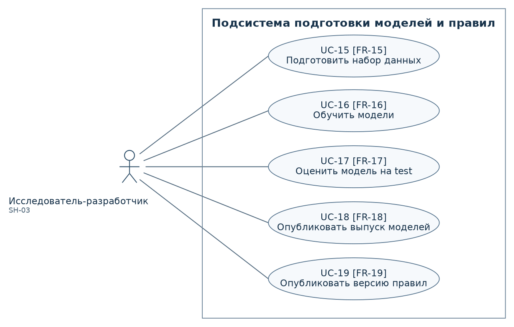

# Лабораторная работа № 1. Формулирование требований к программной системе

| Поле | Значение |
|---|---|
| Студент | Киров Дмитрий Владимирович |
| Группа | РИС-23-3 |
| Вариант | Индивидуальная тема ВКР «Разработка системы для повышения эффективности пользовательских интерфейсов информационных систем на основе прогнозирования зрительного внимания и аффордансной разметки» |
| Постановка задачи | [README репозитория](../../README.md) |
| Репозиторий | [Allabari47/software-architecture-labs](https://github.com/Allabari47/software-architecture-labs) |
| Дата подготовки | 27.11.2026 |
| Срок сдачи по заданию | 06.12.2026 |

**Тема:** анализ предметной области и формулирование требований к программной системе.

**Цель:** проанализировать задачу, выделить заинтересованных лиц, сформулировать функциональные и нефункциональные требования и представить взаимодействие пользователей с системой на диаграмме вариантов использования.

## Краткое описание системы

Пользователь загружает скриншот и получает прогнозную карту внимания, рамки элементов и оценку действий, которые предполагает их внешний вид. Если он описал назначение или значимость элемента, то может связать описание с рамкой в готовом отчёте. По подтверждённым данным система проверяет правила и предлагает изменения для последующей проверки с пользователями. Собственный анализ может запустить дизайнер, аналитик, владелец интерфейса или исследователь-разработчик.

Значимость элемента для конкретной задачи указывает пользователь. Система не устанавливает его намерение по изображению.

## Оглавление

1. [Заинтересованные лица](#1-заинтересованные-лица)
2. [Функциональные требования](#2-функциональные-требования)
3. [Диаграмма вариантов использования](#3-диаграмма-вариантов-использования)
4. [Нефункциональные требования](#4-нефункциональные-требования)
5. [Предположения](#5-предположения)

## 1. Заинтересованные лица

Заинтересованных лиц три. Дизайнер, владелец интерфейса и исследователь могут самостоятельно пройти весь сценарий анализа. Влияние оценено по тому, какие решения о проектируемой системе зависят от роли.
Владелец интерфейса представляет внешнего заказчика (A-02). Сведения о назначении может предоставить и дизайнер. В отчёт их вносит пользователь, открывший свою сессию.

| ID | Стейкхолдер | Роль | Интересы / цели | Влияние и обоснование |
|---|---|---|---|---|
| SH-01 | UX/UI-дизайнер или аналитик | Основной пользователь | Находить неоднозначные или малозаметные элементы и выбирать, что проверить на пользователях | Высокое. От его рабочих задач зависят содержание отчёта и сценарий проверки его понятности (NFR-04) |
| SH-02 | Владелец анализируемого интерфейса | Внешний заказчик и пользователь анализа | Учитывать назначение элементов своего интерфейса и выбирать изменения для проверки | Среднее. Его обратная связь уточняет, полезны ли объяснения и рекомендации для заказчика. За состав и устройство сервиса отвечает разработчик |
| SH-03 | Исследователь-разработчик | Пользователь анализа и подсистемы подготовки моделей | Подготавливать и оценивать модели; управлять воспроизводимыми конфигурациями правил | Высокое: определяет условия применимости моделей и критерии формирования рекомендаций |

## 2. Функциональные требования

В целевой версии 20 функций. FR-01–FR-14 и FR-20 относятся к анализу, FR-15–FR-19 — к подготовке моделей и правил. Приоритеты заданы для первой рабочей версии приложения. К Must относятся функции, без которых нельзя получить объяснимый отчёт по элементам, безопасно обработать вход или воспроизвести использованный выпуск. Should нужен для удобства обмена и повторных экспериментов, когда основной сценарий уже работает. В графе «Стейкхолдер» указано, кому прежде всего нужен результат. Ввод сведений и подтверждение рамки добровольны для пользователя. Поддержка этих действий обязательна для проверки R-01 и R-02.

| ID | Требование | Стейкхолдер | Приоритет | Обоснование |
|---|---|---|---|---|
| FR-01 | Пользователь может загрузить скриншот интерфейса в формате PNG или JPEG | SH-01, SH-02, SH-03 | Must | Скриншот служит исходным материалом для обеих моделей |
| FR-02 | Пользователь может задать тип интерфейса: веб, десктопный или мобильный | SH-01, SH-02, SH-03 | Must | Тип задаёт пользователь. По нему система сверяет применимость моделей к этому скриншоту |
| FR-03 | Пользователь может запустить анализ скриншота с выбранным типом интерфейса | SH-01, SH-02, SH-03 | Must | С этого действия начинается обработка пользовательского запроса |
| FR-04 | Система должна проверять входные данные по формату изображения и опубликованным лимитам | SH-01, SH-02, SH-03 | Must | Бэкенд должен отклонить повреждённый или слишком большой вход до вычислений |
| FR-05 | Система должна формировать список найденных UI-элементов с уникальным в пределах анализа ID и прямоугольными границами в координатах исходного скриншота | SH-01, SH-03 | Must | Без рамок и ID нельзя отнести прогноз или замечание к конкретному элементу |
| FR-06 | Система должна строить прогнозную карту зрительного внимания, пространственно совмещённую с исходным скриншотом | SH-01, SH-02, SH-03 | Must | Прогноз распределения внимания входит в основной результат даже при отсутствии описаний |
| FR-07 | Система должна рассчитывать для каждого выделенного элемента долю прогнозируемого внимания как сумму нормированной карты внутри его границ | SH-01, SH-03 | Must | R-01 сравнивает внимание к конкретным элементам, для этого ему нужны численные оценки по рамкам |
| FR-08 | Система должна оценивать для каждого элемента множество воспринимаемых действий из набора click, input, scroll, drag с оценкой уверенности по каждому действию и отдельным статусом определённости результата | SH-01, SH-03 | Must | Оценки действий нужны для разметки аффордансов и проверки расхождений по R-02 |
| FR-09 | Система должна оценивать каждый элемент по версионируемым правилам выявления потенциальных проблем | SH-01, SH-02, SH-03 | Must | Только проверка применимости и условий даёт основание для замечания |
| FR-10 | Система должна для каждой выявленной проблемы формировать рекомендацию с предлагаемым изменением и пояснением его связи с проблемой | SH-01, SH-02 | Must | Для каждого найденного расхождения пользователь должен понимать, что стоит проверить или изменить |
| FR-11 | Пользователь может просмотреть отчёт со скриншотом, картой внимания, разметкой, оценками элементов, результатами правил, рекомендациями и предупреждениями о выходе за условия применимости моделей | SH-01, SH-02, SH-03 | Must | Пользователь должен увидеть прогноз, основания замечаний и ограничения применимости |
| FR-12 | Пользователь может выгрузить завершённый отчёт в JSON с данными элементов, результатами проверок и идентификаторами конфигурации анализа | SH-02, SH-03 | Should | Отчёт целиком доступен в браузере. Файл нужен для передачи или повторной обработки вне приложения |
| FR-13 | Пользователь может предоставить дополнительные сведения о функциях элементов в виде структурированного описания с привязкой к области скриншота, источником сведений и статусом проверки поведения | SH-01, SH-02, SH-03 | Must | R-01 опирается на указанную значимость, R-02 — на описание функции. Оба вида сведений вводятся по желанию пользователя |
| FR-14 | Система должна сопоставлять воспринимаемые действия с описанием функции для подтверждённой пары «описание — элемент» | SH-01, SH-02, SH-03 | Must | Для R-02 требуется сравнение прогноза и описания одного и того же элемента |
| FR-15 | Система должна формировать версионируемый набор данных с фиксированным разбиением для обучения и оценки | SH-03 | Should | Автоматическая подготовка нужна для новых наборов. Для первого выпуска можно импортировать заранее подготовленные данные с зафиксированным разбиением |
| FR-16 | Система должна обучать модели внимания и аффордансов по выбранной конфигурации | SH-03 | Should | Обучение в подсистеме нужно для повторных экспериментов. Анализ может работать с ранее обученными весами и их протоколом оценки |
| FR-17 | Система должна формировать протокол итоговой оценки зафиксированной модели на тестовой выборке | SH-03 | Must | Перед публикацией требуются сведения о качестве модели и выборке, на которой получены оценки |
| FR-18 | Система должна публиковать версионируемый выпуск моделей для анализа | SH-03 | Must | По ID выпуска бэкенд и ML-сервис должны однозначно установить состав моделей и предобработку |
| FR-19 | Пользователь может опубликовать проверенную версию правил рекомендаций через подсистему подготовки | SH-03 | Should | Публикация из CLI нужна при смене правил. Первую проверенную версию можно загрузить в реестр при развёртывании |
| FR-20 | Пользователь может подтвердить привязку описания области к найденной рамке в готовом отчёте | SH-01, SH-02, SH-03 | Must | Без подтверждения нельзя достоверно отнести описание области к найденному элементу |

**Границы текущей версии (Won’t)**

| Возможность | Для кого | Основание исключения |
|---|---|---|
| Обучение собственного детектора элементов | SH-03 | В выпуск входит готовый локальный детектор (A-11). Обучение моделей внимания и аффордансов остаётся в FR-16 |
| Анализ видеозаписи или последовательности экранов | SH-01, SH-02 | Единица анализа — один статический скриншот (A-01) |
| Определение значимости элемента для задачи по одному изображению | SH-01, SH-02 | Значимость задаёт пользователь с учётом своей задачи (A-09) |
| Исполнение присланного кода и переход по ссылкам для проверки поведения | SH-02 | Политика обработки входов требует читать эти фрагменты как текст (NFR-03) |

### Уточнения к требованиям

В FR-07 проверяются размер и совмещение карты с изображением, конечность и неотрицательность значений и положительная сумма. Нарушение любого условия завершает задачу ошибкой без частичного отчёта. Валидная карта нормируется до суммы 1. Оценка элемента равна сумме в его прямоугольнике. Пересекающиеся рамки могут содержать одни и те же пиксели, поэтому сумма оценок элементов может превышать 1.

В FR-08 click означает нажатие, input ввод, scroll прокрутку, drag перетаскивание. Например, поле ввода может восприниматься одновременно как нажимаемое и допускающее ввод. Для результата с достаточной определённостью пустое множество действий обозначается none. Статус unclear означает, что надёжно определить набор действий нельзя; он не заменяет none и не является действием. Оценки уверенности являются выходами модели и без отдельной калибровки не трактуются как вероятности правильного ответа. Дополнительные сведения о функциях не изменяют визуальный прогноз: результаты хранятся раздельно.

В FR-13 описание содержит координаты области, допустимые действия, текст функции и источник: описание пользователя, фрагмент DOM, дерево Accessibility или исходный код. Статус поведения задаётся как «не проверено» или «проверено пользователем»; для второго указываются способ и условия проверки. Для списка действий отмечается, является ли он полным. Значимость элемента для задачи может задаваться дополнительно. Фрагменты кода принимаются как текст и не исполняются. До запуска анализа пользователь в своей сессии отмечает область на исходном скриншоте и вносит описание. Если сведения дал владелец интерфейса вне приложения, его указывают как источник. Рамки доступны в завершённом первичном отчёте. Пользователь может подтвердить выбранную пару через FR-20 или пропустить этот шаг. До подтверждения описание не участвует в проверках. Скриншота и типа интерфейса достаточно для первичного анализа.

В FR-14 при неполном описании отсутствие действия в описании не считается свидетельством невозможности действия. Результат сопоставления содержит общий набор действий, различия и основание сравнения. DOM и Accessibility дают сведения о структуре и заявленных свойствах; отметка проверки поведения указывается вместе с её источником и не означает независимой проверки системой.

Для FR-09 применяются правила двух типов:

| ID | Условие применимости | Потенциальная проблема | Основание рекомендации |
|---|---|---|---|
| R-01 | Есть подтверждённая связь с описанием, в нём указана значимость для задачи. Для элемента определены группа сравнения и порог внимания | Недостаточное прогнозируемое внимание к значимому элементу по выбранному критерию | Проверить визуальное выделение и положение элемента в контексте задачи |
| R-02 | Пользователь подтвердил рамку для описания функций. Уверенности визуального прогноза достаточно для сравнения | Расхождение воспринимаемых действий с описанными функциями элемента | Проверить соответствие визуальных признаков заявленному действию; статус проверки поведения включается в формулировку замечания |

R-01 получает оценки только после проверки карты по FR-07. Пользователь задаёт значимость в описании области и подтверждает рамку. Группу сравнения, критерий и порог задаёт версия правила. Если отсутствует привязка, значимость или параметр сравнения, для этого элемента выводится «неприменимо» с причиной.

Низкая оценка внимания без сведений о значимости элемента сама по себе не порождает замечание R-01. Статус unclear отражается в отчёте как ограничение анализа; он не считается проблемой юзабилити и блокирует зависимые выводы R-02. Если данных для правила недостаточно, в отчёте указывается «неприменимо» с причиной. Отсутствие срабатываний означает только отсутствие замечаний по применимым правилам.

В FR-15 исследователь импортирует изображения и подготовленную в локальном инструменте разметку. CLI проверяет рамки, метки действий и связь с исходным изображением, готовит карты внимания и фиксирует разбиение. Один исходный интерфейс и его производные относятся только к одной из выборок. В версии набора сохраняются группы исходных интерфейсов и исключённые записи. Пустой набор действий (none) и неопределённая метка (unclear) учитываются раздельно.

В FR-17 для внимания рассчитываются CC, KL, NSS и SIM. Для многометочных аффордансов в протокол входят precision, recall и F1 по действиям, macro-F1, доля определённых прогнозов и качество на них. Для оценки самой модели аффордансов используются размеченные рамки. В сквозной проверке FR-05–FR-08 модель получает вырезки выбранного детектора. Классы без примеров отмечаются отдельно.

Параметры обучаемых моделей, порог отказа от прогноза и готовый детектор выбирают на validation. Критерии и пороги правил проверяют на размеченных контрольных примерах из validation, разделённых с test по исходным интерфейсам. До обращения к test фиксируют выбор моделей, предобработку, пороги и версию правил. Test предназначен для итоговой оценки. Каждое обращение к нему записывается в журнал. Его результаты не используют для выбора следующей модели, детектора, порога или правила. Протокол сохраняет определения метрик, способ обработки пустых карт и версию расчётного кода.

Для FR-18 исследователь через CLI публикует выпуск и выбирает его для новых задач. Неизменяемый паспорт выпуска перечисляет версии детектора, модели внимания, модели аффордансов и их предобработки. По ним доступны веса, источники, условия применимости и словарь действий. Для обученных в проекте моделей указываются версии данных и протоколы FR-17, для готового детектора — источник и паспорт по A-11. Для первого запуска в реестре задают проверенную версию правил. Публикация последующих версий через CLI относится к FR-19. Задача при регистрации сохраняет обе версии.

В FR-20 повторная проверка работает по сохранённому прогнозу. Она обновляет сопоставление FR-14, результаты R-01 и R-02, замечания, рекомендации и представление JSON. Карта, рамки, оценки и версии моделей сохраняются. Проверка использует версию правил первичного отчёта.

### Проверка функциональных требований

Для каждого требования предусматривается приёмочная проверка:

| Требования | Проверка и ожидаемый результат |
|---|---|
| FR-01–FR-04 | Допустимые PNG/JPEG и каждый тип интерфейса принимаются; повреждённые файлы и входы сверх опубликованных лимитов отклоняются с причиной. Для принятой задачи доступны идентификатор и состояния «принята», «выполняется», «завершена» или «ошибка» |
| FR-05–FR-07 | Проверить уникальность ID, границы рамок и совмещение карты. На синтетической карте абсолютная погрешность суммы внутри заданной рамки не превышает 10⁻⁶. Нулевая сумма, отрицательные или неконечные значения и неверный размер дают ошибку задачи без частичного отчёта |
| FR-08 | Проверены отдельные действия, сочетание click/input, none и unclear. none не совмещается с действиями; unclear не выводится как уверенное отсутствие действий |
| FR-09–FR-10 | Для каждого правила проверить срабатывание, отсутствие срабатывания и неприменимость. У замечания есть ID правила, ID элемента, входные значения, условие и рекомендация. У неприменимого правила есть причина. Один лишь unclear не создаёт замечание |
| FR-11–FR-12 | Сверить экран и JSON по ID, оценкам, сведениям и версиям. Для типа интерфейса вне области применимости одной из моделей экран и JSON содержат её ID, версию и причину предупреждения. Для поддерживаемого типа такого предупреждения нет. Отдельно проверяются пустые списки и неприменимые правила |
| FR-13–FR-14 | При запуске без описаний видны карта, разметка, оценки и причины неприменимости правил. Для подтверждённой пары сверяются общие действия и различия. Отдельные примеры покрывают неполный список действий и отметку поведения «не проверено» |
| FR-15–FR-16 | Проверить разметку рамок и действий, подготовку карт и сохранение разбиения. Набор с пересечением групп исходных интерфейсов отклоняется. Оптимизация использует train, выбор параметров — validation. Журнал содержит версию данных и параметры. Изменение test не влияет на настройку |
| FR-17–FR-18 | Протокол содержит версии весов и данных, размер выборки, метрики по типам интерфейсов и действиям. Сверить время фиксации конфигурации и журнал обращений к test. В записях выбора детектора, моделей, порогов и правил источником примеров служит validation. По ID выпуска восстанавливаются компоненты и предобработка. После публикации нового выпуска прежний отчёт сохраняет свои версии |
| FR-19 | Для каждого правила сохраняются пороги и результаты положительного, отрицательного и неприменимого контрольного примера; изменение правила создаёт новую версию |
| FR-20 | Открыть готовый отчёт с описанием области. Пропуск оставляет его прежним. Подтверждение сохраняет выбранную пару и запускает проверку правил. Число обращений к ML не увеличивается. После успеха экран и JSON показывают одну редакцию. При сбое доступны причина и последняя успешная редакция |

## 3. Диаграмма вариантов использования

На двух диаграммах показаны 20 вариантов использования. К анализу относятся UC-01–UC-14 и UC-20, к подготовке моделей и правил — UC-15–UC-19. Номер UC соответствует номеру FR. Три роли наследуют возможности общего актора «Пользователь анализа». Операции подготовки доступны исследователю через CLI. На диаграммах показаны проектируемые функции Must и Should. Возможности за границами версии в число 20 UC не входят.

### Анализ интерфейса

[Исходник диаграммы](./use-case.puml).

UC-03 включает UC-04–UC-10 как обязательное поведение успешного анализа. Обработка пустого списка элементов и отсутствие срабатываний допускаются внутри этих вариантов. Отказ проверки входа прерывает основной сценарий.

UC-13 позволяет заранее описать область скриншота. UC-20 доступен после завершения UC-03. При подтверждении UC-20 включает проверку правил (UC-09) и формирование рекомендаций (UC-10). Если замечаний нет, результатом UC-10 служит пустой список. UC-14 расширяет UC-09 в точке «сопоставление перед применением правил», если есть подтверждённая пара «описание — рамка». При закрытии отчёта или пропуске привязки UC-20 не запускается. UC-12 доступен для любой завершённой редакции отчёта.

### Подготовка моделей и правил

[Исходник диаграммы](./model-preparation.puml).

UC-15–UC-19 доступны исследователю-разработчику. Обучение требует зафиксированного разбиения, итоговая оценка — зафиксированных весов. При публикации выпуска указываются уже подготовленные модели и протоколы оценки.

### Основной сценарий: анализ скриншота

| Поле | Значение |
|---|---|
| Use Case | UC-03 [FR-03] Запустить анализ |
| Актор | Пользователь: SH-01, SH-02 или SH-03 |
| Предусловия | В текущей сессии выбран скриншот и указан тип. В реестре доступны выпуск моделей и проверенная версия правил. При наличии описаний области размечены через UC-13 |
| Основной поток | 1. Пользователь запускает анализ. 2. Система проверяет файл и выдаёт ID задачи. 3. ML-сервис находит элементы, строит карту внимания и рассчитывает оценки. 4. Бэкенд проверяет применимость правил. 5. Первичный отчёт с картой, рамками, оценками и результатами проверок доступен через UC-11 и UC-12. Действий пользователя между шагами 2 и 5 не требуется |
| Постусловие | Для текущего запроса доступен отчёт с координатами элементов, статусами проверок, источниками дополнительных сведений и версиями моделей и правил |
| Некорректный файл | Система указывает нарушенное ограничение; запрос не передаётся ML-сервису. Пользователь может выбрать другой файл |
| ML-сервис недоступен, ответ некорректен или истекло время ожидания | Система завершает запрос с сообщением об ошибке; не показывает прежний или частичный результат как успешный. Доступен повторный запуск |
| Элементы не найдены | Показывается карта внимания и сообщение об отсутствии выделенных элементов; список рекомендаций пуст |
| Правила не сработали | Если применимые правила выполнены без замечаний, в отчёте показаны оценки и результаты выполненных проверок |
| Только скриншот, оба правила неприменимы | Пользователь получает карту внимания, рамки и оценки найденных элементов. Для R-01 отчёт указывает, что не задана значимость элемента, для R-02 что нет описания его функций. Список рекомендаций пуст |
| Недостаточная уверенность | Элемент отмечается статусом unclear, зависимые проверки исключаются; остальные результаты сохраняются |
| Тип интерфейса вне области применимости модели | Если вход пригоден для расчёта, прогноз показывается вместе с предупреждением, названием модели и причиной ограничения |
| Есть описание области | В завершённом отчёте видны найденные рамки. Пользователь может выбрать одну для UC-20 или оставить описание без привязки. При отсутствии подходящей рамки отчёт остаётся доступным |

### Дополнительный сценарий: выгрузка результата

| Поле | Значение |
|---|---|
| Use Case | UC-12 [FR-12] Выгрузить JSON |
| Актор | Пользователь анализа; прежде всего SH-02 и SH-03 |
| Предусловие | Завершённый отчёт доступен по ID в создавшей задачу сессии, срок доступа ещё не истёк |
| Основной поток | 1. Пользователь выбирает выгрузку. 2. Система формирует JSON для текущего результата. 3. Браузер предлагает сохранить файл |
| Постусловие | Передан файл с полями FR-12; просмотр результата остаётся доступным |
| Альтернативный поток | При ошибке выгрузки система сообщает о ней и сохраняет возможность просмотра результата |

## 4. Нефункциональные требования

Выбраны пять свойств: отзывчивость, устойчивость к отказам, защита данных, удобство использования и воспроизводимость. Численные значения являются проектными критериями приёмки. Условия измерений и конфигурация испытательного стенда фиксируются в протоколе. Целевые показатели масштабирования и круглосуточной доступности для учебного прототипа не заданы.

| ID | Категория | Требование | Метрика / критерий приёмки | Почему выбрано |
|---|---|---|---|---|
| NFR-01 | Отзывчивость | Регистрация задачи и получение статуса завершаются до ответа ML-сервиса | При двух одновременных анализах p95 регистрации и p95 чтения статуса по отдельности не превышают 2 с. Две серии по 100 измерений описаны ниже | Пользователь получает ID и состояние во время длительного расчёта |
| NFR-02 | Надёжность | Сбой ML-сервиса переводит задачу в состояние «ошибка» с понятной пользователю причиной | По 5 испытаний для немедленного отказа соединения, некорректного ответа и зависания. Максимум 5 с для явного отказа и T + 5 с для зависания при T = 30 с на стенде. После восстановления очередной запрос завершается без перезапуска бэкенда | Отказ вычислительного сервиса должен затрагивать только его задачу |
| NFR-03 | Защита данных | Входные данные должны быть изолированы между сессиями и обрабатываться без исполнения присланного кода | Шесть проверок. (1) Чужая сессия получает отказ при запросе статуса, отчёта, JSON и подтверждении рамки. (2) HTML и скрипт видны как текст. (3) Обращений по ссылкам из описаний — 0. (4) Для повреждённого файла и входа сверх лимита вызовов ML — 0. (5) Проверить отказ в доступе на 60-й минуте и удаление данных из прикладного хранилища к 65-й минуте при работающем сервисе. Если срок истёк при выключенном сервисе, проверить очистку до открытия API после запуска (A-06). (6) В журналах API, обработчика и ML-сервиса отсутствуют изображения и тексты описаний. Приёмка требует успешного прохождения всех шести проверок | Скриншоты и сведения о функциях могут содержать закрытые данные |
| NFR-04 | Удобство использования | Пользователь самостоятельно проходит основной сценарий и понимает ограничения вывода | Успех как минимум у 4 из 5 новых пользователей. Один участник засчитывается, только если уложился в 3 мин активной работы и верно объяснил все три примера. Сценарий и ключ приведены ниже. Интерфейс и ошибки на русском языке | Помогает корректно использовать прогноз при выборе элементов для проверки |
| NFR-05 | Воспроизводимость и прослеживаемость | Каждый отчёт и запуск обучения должны однозначно определять использованные данные и конфигурацию | В 100% отчётов указаны SHA-256 переданных файлов и канонического JSON параметров (тип, описания, подтверждённые пары), ID выпуска, версии детектора, обеих моделей, предобработки и правил. Журнал обучения дополнительно содержит разбиение данных, параметры, seed и программное окружение. Повторное применение одной версии правил к одним сохранённым оценкам и сведениям даёт одинаковые ID замечаний и рекомендации в 5 из 5 запусков | Позволяет объяснить результат и проверить влияние изменений конфигурации |

**Процедура NFR-01.** Выполнить 50 пар запросов. В каждой паре две сессии одновременно передают по одному валидному скриншоту. Стенд допускает два параллельных расчёта, ML-заглушка задерживает каждый ответ на 10 с при T = 30 с. Получив оба ID, одновременно запросить статус каждой задачи по одному разу, пока заглушка ещё считает. Следующую пару начать после завершения предыдущей. Регистрацию измерять на стороне API от окончания проверки входа до отправки ответа с ID, статус — от получения GET до отправки ответа. Время загрузки и проверки файла учитывается отдельно. Для каждого из двух рядов упорядочить 100 замеров и сравнить 95-е значение с 2 с. В каждой паре оба ID и оба статуса должны быть доступны до ответа заглушки по соответствующей задаче.

**Процедура NFR-02.** Стенд фиксирует по ID задачи и попытки время захвата задания, сетевые события и первое появление статуса «ошибка» по одним монотонным часам. Статус опрашивается каждые 100 мс. При немедленном отказе соединения отсчёт 5 с начинается с зарегистрированного отказа подключения, при некорректном ответе — с отправки заглушкой последнего байта ответа. Используются ответы с неверной схемой, ID запроса, выпуском или картой. Для зависания заглушка оставляет соединение открытым, а 35 с отсчитываются от захвата текущей попытки. Во всех испытаниях проверяются причина в своей сессии и сохранность результатов других задач.

**Процедура NFR-04.** Пригласить пять дизайнеров, аналитиков или владельцев интерфейсов, которые впервые видят приложение. Каждый без подсказок загружает скриншот, задаёт тип, запускает анализ и находит пояснение к указанному элементу. Таймер активной работы ставится на паузу на время расчёта. Затем участник объясняет три примера своими словами. Ответ засчитывается по смыслу.

| Что видит участник | Какой вывод ожидается |
|---|---|
| Для разделителя указан статус `none` | Модель достаточно уверенно предсказывает пустой набор среди четырёх оцениваемых действий |
| Для пиктограммы указан статус `unclear` | Модели не хватило уверенности, чтобы определить набор действий |
| Для кнопки у R-01 указано «неприменимо», причина — «не задана значимость» | Данных для проверки правила недостаточно. По этому правилу вывод о проблеме сделать нельзя |

Приёмка расчётной логики и оценка ML-качества выполняются раздельно. Для оценки качества используется протокол FR-17 с фиксированным тестовым набором и результатами по классам и типам интерфейсов. Условия применимости конкретной модели задаются её паспортом; система показывает предупреждение, если вход выходит за эти условия.

## 5. Предположения

| ID | Предположение | Влияние на требования и обоснование |
|---|---|---|
| A-01 | Единица анализа представляет собой статический скриншот в PNG/JPEG. Динамика взаимодействия оценивается только через предоставленное описание поведения | FR-01, FR-13–FR-14; соответствует входу системы и не предполагает наблюдения действий по одному изображению |
| A-02 | Владелец интерфейса находится вне команды разработки анализирующей системы и может предоставлять сведения о назначении элементов | SH-02, FR-13; позволяет учитывать предметный контекст интерфейса |
| A-03 | Максимальный объём файлов, суммарного запроса и число пикселей задаются в конфигурации развёртывания и показываются до загрузки. Если лимиты не настроены, загрузка отключена до исправления конфигурации. Приёмочные тесты проверяют значения на границе и выше неё | FR-04, NFR-03; лимиты зависят от ресурсов обработки, а не от разрешения обучающих изображений |
| A-04 | Тип интерфейса задаётся пользователем. Дополнительные сведения передаются в структурированной форме; DOM, Accessibility и код служат источниками фрагментов описания, а не исполняемыми инструкциями | FR-02, FR-13–FR-14; обеспечивает единый контракт для веб-, мобильных и десктопных интерфейсов |
| A-05 | Прогноз внимания, воспринимаемые действия и сведения о функциях хранятся раздельно. Статусы none и unclear взаимоисключающи; несколько действий допускаются. Пересекающиеся рамки оцениваются независимо | FR-07–FR-09; сохраняет различие между наблюдаемым видом, прогнозом и описанием поведения |
| A-06 | Скриншот, описания, привязки, прогноз и редакции отчёта доступны до истечения 60 минут с момента завершения или отказа первичной задачи. Пересчёт не продлевает срок. Пользователь видит время окончания доступа. При штатной работе записи удаляются из прикладного хранилища в течение следующих 5 минут. При простое просроченные данные очищаются перед возобновлением обслуживания | FR-11–FR-14, FR-20, NFR-03. Срок относится к пользовательским данным. Учебные наборы и версии моделей хранятся отдельно. Пользовательские материалы не пополняют их автоматически |
| A-07 | Подготовка моделей запускается исследователем через CLI в управляемой среде. Ручную разметку исследователь выполняет в отдельном локальном инструменте, экспортирует в файл и передаёт CLI для импорта и проверки. Обучение выполняется отдельным процессом | FR-15–FR-19, NFR-01, NFR-03. У веб-приложения нет зависимости от редактора разметки во время анализа |
| A-08 | Для проверки отзывчивости используется профиль из двух одновременных анализов. CPU, RAM, ускоритель, версии ПО, размеры входов и лимит T фиксируются до испытаний. Это профиль приёмочного испытания, а не ограничение числа пользователей | NFR-01–NFR-02; делает измерения сопоставимыми без привязки к личному оборудованию |
| A-09 | Значимость элемента для задачи и полноту списка действий указывает пользователь. Группы сравнения, пороги и остальные условия правил фиксируют по контрольным примерам validation до итоговой оценки. Контрольные примеры и test моделей разделены по исходным интерфейсам | FR-09, FR-13–FR-14, FR-17, FR-19. Правила применяются в зафиксированной версии, решение можно проверить по входным данным |
| A-10 | Анализ интерфейса и подготовка моделей являются отдельными контурами одной системы. Модели загружаются из хранилища по версии; правила рекомендаций хранятся независимо от весов | FR-15–FR-19, NFR-05; соответствует разделению анализа, обучения и базы правил |
| A-11 | В выпуск входит готовый детектор, пригодный для локального запуска. При реализации его выбирают по поддерживаемым типам интерфейса и качеству рамок на размеченной части validation. Набор test сохраняется для итоговой оценки | FR-05, FR-17–FR-18, NFR-05. Паспорт фиксирует источник, версию весов, предобработку, условия применимости и результат проверки |
| A-12 | Интерфейс и сообщения пользователю выдаются на русском языке. Для анализа пользователь предоставляет материалы, которыми вправе распорядиться для этой цели. Для учебных наборов исследователь фиксирует источник и условия использования | FR-01, FR-13, FR-15, NFR-04. Эти условия учитываются при отборе входов и участников приёмки |
| A-13 | Для веб-анализа достаточно сессии браузера. Статус, отчёт, JSON и подтверждение рамки доступны только сессии, создавшей задачу. Для обсуждения с другим человеком пользователь может передать выгруженную копию JSON вне приложения | SH-01–SH-03, FR-11–FR-13, FR-20, NFR-03. Совместное редактирование и учётные записи не входят в текущую версию |
