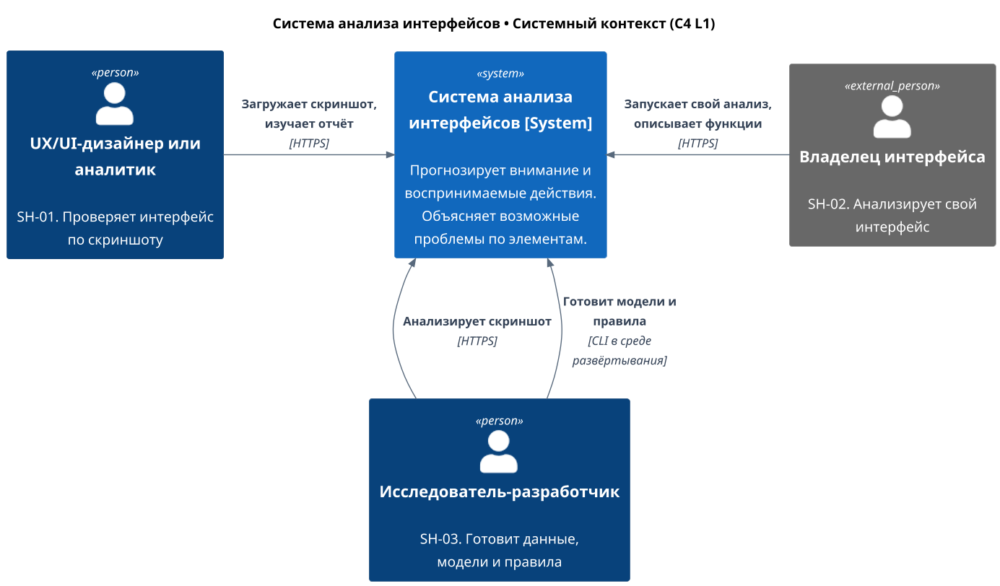
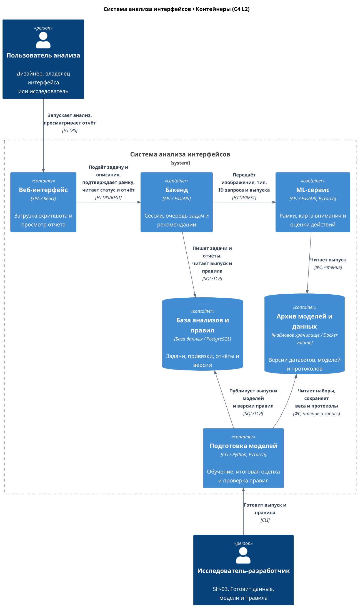
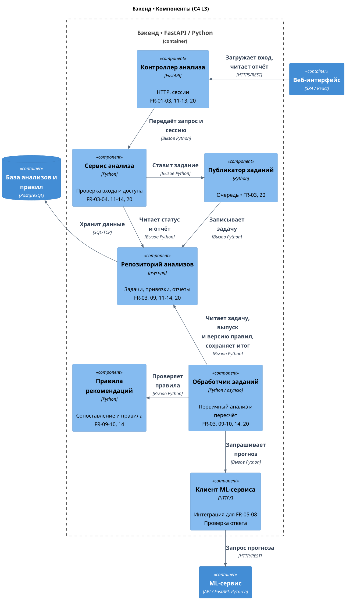
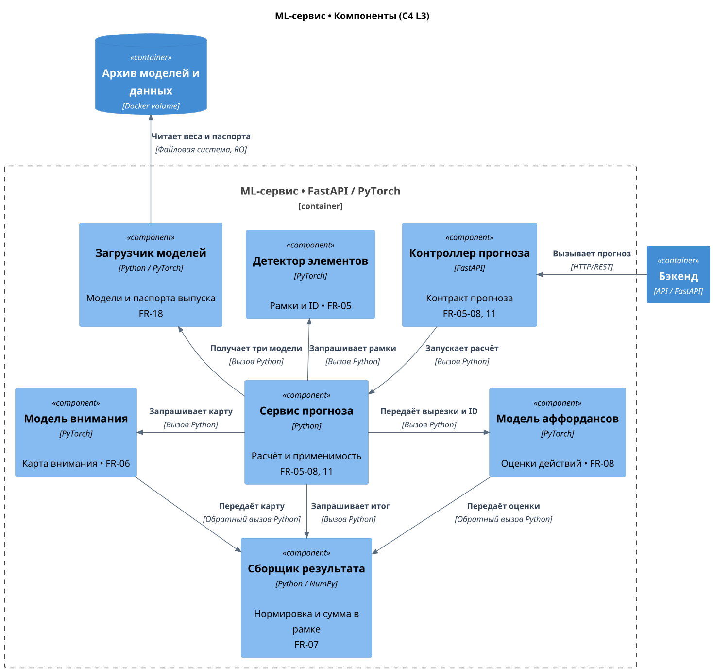

# Лабораторная работа № 2. Архитектура системы анализа интерфейсов в нотации C4

| Поле | Значение |
|---|---|
| Студент | Киров Дмитрий Владимирович |
| Группа | РИС-23-3 |
| Вариант | Индивидуальная тема ВКР «Разработка системы для повышения эффективности пользовательских интерфейсов информационных систем на основе прогнозирования зрительного внимания и аффордансной разметки» |
| Исходные требования | [Лабораторная работа № 1](../../Lab%20Work%20%E2%84%961/docs/LAB_1_REPORT.md) |
| Репозиторий | [Allabari47/software-architecture-labs](https://github.com/Allabari47/software-architecture-labs) |
| Инструмент | C4-PlantUML, PlantUML 1.2025.4 |
| Дата подготовки | 27.11.2026 |
| Срок сдачи по заданию | 13.12.2026 |

**Тема работы.** Использование нотации C4 для проектирования архитектуры программной системы.  
**Цель работы.** Зафиксировать границы системы, способ взаимодействия её частей и распределение ответственности между компонентами.

## Краткое описание системы

Дизайнер, владелец интерфейса или исследователь загружает скриншот в своей сессии и указывает тип интерфейса. Пользователь, который запускает анализ, может заранее описать области экрана, в том числе со слов владельца интерфейса. Система выделяет элементы, строит прогнозную карту внимания и оценивает воспринимаемые действия. В готовом отчёте тот же пользователь может связать описание с рамкой и получить рекомендации по применимым правилам.

На архитектуру влияют время ответа API (NFR-01), обработка отказа ML-сервиса (NFR-02), изоляция пользовательских данных (NFR-03), понятность результата (NFR-04) и воспроизводимость анализа (NFR-05). Все четыре схемы описывают проектное решение. Выбранные технологии и показатели приёмки относятся к планируемой реализации.

Стрелка указывает от инициатора к получателю. Для вызова с ответом показана одна стрелка. Тип элемента указан стереотипом C4 над названием. Пунктирная рамка обозначает границу системы или рассматриваемого контейнера.

## Оглавление

1. [Системный контекст](#1-системный-контекст)
2. [Контейнеры и архитектурный стиль](#2-контейнеры-и-архитектурный-стиль)
3. [Компоненты бэкенда](#3-компоненты-бэкенда)
4. [Компоненты ML-сервиса](#4-компоненты-ml-сервиса)

## 1. Системный контекст

[Редактируемая диаграмма](./c4/01-context.puml)

| Элемент | Тип | Взаимодействие |
|---|---|---|
| Система анализа интерфейсов | System | Принимает скриншот и возвращает результаты по элементам. Поддерживает подготовку данных, моделей и правил. |
| UX/UI-дизайнер или аналитик (SH-01) | Person | Загружает скриншот, изучает распределение внимания и основания замечаний. |
| Владелец анализируемого интерфейса (SH-02) | Person_Ext | Запускает анализ в своей сессии, описывает функции элементов и подтверждает рамки в отчёте. Принимает решения о доработке своего интерфейса вне приложения. |
| Исследователь-разработчик (SH-03) | Person | Пользуется анализом через веб-интерфейс. В управляемой среде запускает подготовку выборок, обучение, оценку и публикацию версий через интерфейс командной строки (CLI). |

**Внешние интеграции**

| Внешняя система | Протокол | Назначение |
|---|---|---|
| Автоматических внешних интеграций нет | — | Анализ выполняется по переданному скриншоту и описаниям. Фрагменты DOM, дерева доступности и кода принимаются как текст. Исследователь сам размещает UEyes и файлы разметки в рабочем каталоге (A-04, A-07, NFR-03) |

## 2. Контейнеры и архитектурный стиль

Граница охватывает шесть контейнеров C4. Веб-интерфейс работает в браузере, бэкенд и ML-сервис развёртываются отдельно и обмениваются запросами по сети. Обучение выполняется отдельным процессом по команде исследователя. Два хранилища различаются по сроку жизни данных и способу доступа.

[Редактируемая диаграмма](./c4/02-containers.puml)

| Контейнер | Тип и технология | Ответственность | Связь с требованиями ЛР № 1 |
|---|---|---|---|
| Веб-интерфейс | SPA, React | Принимает файл, тип и описания областей. Показывает статус и отчёт. В готовом отчёте можно подтвердить рамку и выгрузить JSON. | FR-01–03, FR-11–13, FR-20 |
| Бэкенд | Сетевой API, Python / FastAPI | Проверяет вход и сессию, ставит задания в очередь, вызывает ML-сервис и формирует отчёт. Обрабатывает подтверждение привязки. | FR-01–04, FR-09–14, FR-20 |
| ML-сервис | Сетевой API, FastAPI / PyTorch | Получает скриншот, тип интерфейса, ID запроса и выпуска. Возвращает карту, рамки, оценки, ID запроса, фактические версии и предупреждения из паспортов моделей. | FR-05–08, FR-11, FR-18 |
| Подготовка моделей | Пакетный процесс, Python / PyTorch, CLI | Импортирует файлы ручной разметки из локального инструмента и формирует разбиение. На train обучает модели, на validation выбирает параметры и готовый детектор. Пороги правил проверяет той же библиотекой, что и бэкенд, на контрольных примерах validation. Перед оценкой на test фиксирует модели, пороги и правила. В журнале обращений к test сохраняет ID запуска, версии данных и конфигурации, время и ссылку на результат. | FR-15–19 |
| База анализов и правил | Реляционная БД, PostgreSQL | Хранит задачи, сессии, входы, описания областей, привязки, прогнозы и редакции отчётов. Отдельная схема содержит реестр выпусков, версии правил и текущий выбор для новых задач. | FR-03, FR-09–14, FR-18–20 |
| Архив моделей и данных | Именованный том Docker с файловым доступом | Хранит по версиям наборы, веса и паспорта трёх компонентов, предобработку, журналы и протоколы. CLI пишет новые версии. ML-сервис монтирует каталог выпусков только для чтения. | FR-15–18 |

На схеме роль «Пользователь анализа» объединяет дизайнера, владельца интерфейса и исследователя. Все трое могут запускать анализ через веб-интерфейс. Исследователь также запускает подготовку через CLI. ФС обозначает файловую систему тома Docker.

**Почему выбран этот стиль.** Интерактивный анализ спроектирован в сервисном стиле (service-based) с двумя независимо развёртываемыми сервисами — модульным бэкендом и ML-сервисом. В монолите сбой процесса с моделями мог бы остановить и API, а отдельный ML-сервис позволяет обслужить следующий запрос после восстановления модели без перезапуска бэкенда (NFR-02). При нагрузке из двух одновременных анализов разделение сессий, правил и отчётов на микросервисы добавило бы сетевые вызовы и усложнило согласование данных одной задачи (A-08). Событийная архитектура с отдельным брокером потребовала бы согласовывать запись входа в БД с доставкой сообщения. Очередь в PostgreSQL позволяет одной транзакцией сохранить задание, сессию и версии, а затем вернуть пользователю ID до получения прогноза (NFR-01, NFR-03, NFR-05).

**Первичный анализ.** Бэкенд проверяет файл и в одной транзакции создаёт задачу, сохраняет SHA-256 файла и канонического JSON параметров, а также действующие ID выпуска моделей и версии правил. Пользователь получает ID задачи и запрашивает её состояние. Обработчик получает прогноз по зафиксированному выпуску. В первичном отчёте доступны карта, рамки и оценки. Если значимость или назначение элемента ещё не связаны с рамкой, соответствующее правило имеет статус «неприменимо» с причиной.

**Подтверждение рамки.** Пользователь в той же сессии открывает готовый отчёт и выбирает рамку для описанной области (UC-20). При пропуске ничего пересчитывать не требуется. При подтверждении бэкенд одной транзакцией сохраняет снимок привязок и создаёт задание повторной проверки. Для каждой пары в БД записаны ID исходной задачи, описания, рамки и сессии, а также время подтверждения. Обработчик берёт сохранённые оценки и исходную версию правил. Он пересчитывает FR-14, R-01, R-02 и рекомендации без обращения к ML. По успеху экран и JSON получают одну новую редакцию отчёта с SHA-256 обновлённых параметров. По ошибке видны причина и последняя успешная редакция. Для каждого подтверждения проверяется номер исходной редакции. Если с неё уже запущен пересчёт или редакция устарела, интерфейс предлагает обновить отчёт.

**Публикация выпуска.** Исследователь запускает CLI в рабочей среде. У каждого выпуска есть неизменяемый паспорт с версиями детектора, модели внимания, модели аффордансов и их предобработки. Сначала CLI сохраняет файлы выпуска в архиве, затем регистрирует готовый выпуск в БД. При развёртывании в реестр загружают стартовую версию правил с результатами проверки. Через CLI исследователь может публиковать следующие версии (FR-19). Для новых задач он выбирает выпуск и версию правил. Этот выбор меняется одной транзакцией. Уже принятые задачи и повторные проверки сохраняют исходную конфигурацию.

## 3. Компоненты бэкенда

В этом контейнере сосредоточены решения о том, кто имеет доступ к анализу, какие данные нужны для проверки и как объяснить результат пользователю. Внутри его границы семь компонентов. Веб-интерфейс, ML-сервис и БД показаны за границей как непосредственные соседи.

[Редактируемая диаграмма](./c4/03-backend.puml)

| Компонент | Роль | Технология | Ответственность и FR |
|---|---|---|---|
| Контроллер анализа | API | FastAPI | Принимает файл, тип и описания, определяет сессию. Выдаёт статус, отчёт и JSON. Принимает подтверждение с ID описания, рамки и редакции. FR-01–03, FR-11–13, FR-20. |
| Сервис анализа | Прикладной сервис | Python | Проверяет формат, декодируемость и лимиты. Проверяет владельца задачи и принадлежность рамки и описания этому анализу. Запрашивает регистрацию задачи или пересчёт. FR-03–04, FR-11–14, FR-20. |
| Публикатор заданий | Публикация задания | Python | Передаёт репозиторию первичное задание или задание пересчёта. Запись о задании и его входы сохраняются атомарно. FR-03, FR-20. |
| Обработчик заданий | Фоновый прикладной сервис | Python / asyncio | Берёт задание, закреплённые выпуск и версию правил. Для первичного анализа вызывает ML, при подтверждении рамки использует сохранённые оценки. Передаёт их модулю правил и записывает итог попытки. По таймеру инициирует очистку (A-06). FR-03, FR-09–10, FR-14, FR-20. |
| Правила рекомендаций | Предметный сервис | Python | Сопоставляет действия с описанием функции (FR-14). R-01 проверяет внимание к рамке с указанной значимостью. Для R-02 учитывает уверенность и полноту описания, включает источник сведений и статус проверки поведения в замечание. Для каждого срабатывания формирует рекомендацию, при неприменимости указывает причину. FR-09–10, FR-14. |
| Репозиторий анализов | Репозиторий | psycopg / SQL | Сохраняет задачи, версии, хеши входов, привязки, прогнозы и редакции отчёта. Выбирает данные по сессии и задаче, выдаёт задания, удаляет просроченные данные. FR-03, FR-09, FR-11–14, FR-20. |
| Клиент ML-сервиса | Сетевой адаптер | HTTPX | Интеграция для FR-05–08. Передаёт изображение, тип, ID запроса и выпуска. Проверяет срок ожидания, схему ответа, ID, версии и карту. У карты должны совпадать размеры со скриншотом, все значения конечны и неотрицательны, сумма нормированной карты отличается от 1 не более чем на 10⁻⁶. Передаёт предупреждения о применимости в отчёт (FR-11). |

**Очередь и сбои.** Первичный анализ и пересчёт имеют собственные ID и состояния «принята», «выполняется», «завершена», «ошибка». При захвате задания обработчик записывает номер попытки и время её начала. После перезапуска возможен повторный захват просроченной записи с новым номером и временем. Лимит T отсчитывается от захвата текущей попытки (на приёмочном стенде 30 с). Итог принимается только от активной попытки. Недоступность ML-сервиса, тайм-аут, неверная структура ответа, ID или карта завершают первичную задачу ошибкой без частичного отчёта. Веб-интерфейс показывает причину. При сбое пересчёта сохраняется доступ к предыдущей опубликованной редакции.

**Доступ и хранение.** Задача принадлежит создавшей её сессии браузера (A-13). Бэкенд проверяет сессию и срок доступа перед выдачей статуса, отчёта, JSON и при подтверждении рамки. Отметка окончания доступа равна времени завершения или ошибки первичной задачи плюс 60 минут. После этой отметки доступ закрыт. Пересчёт срок не продлевает. Обработчик заданий раз в минуту вызывает очистку в репозитории. В работающей системе скриншот, описания, привязки, сохранённый прогноз и отчёты удаляются из прикладного хранилища не позднее чем через 5 минут после окончания доступа. При восстановлении бэкенд выполняет очистку до приёма запросов и возобновления заданий. Перед записью результата повторной проверки репозиторий сверяет исходную задачу, срок доступа и номер активной попытки.

Код и HTML обрабатываются как текст. Журналы API, обработчика и ML-сервиса содержат ID задания и попытки, временные метки и коды ошибок. Изображения и тексты описаний в журналы не записываются. CLI исследователя читает учебные наборы из отдельного каталога архива. Его роль PostgreSQL может изменять только реестр выпусков, правила и текущую конфигурацию.

## 4. Компоненты ML-сервиса

ML-сервис выбран для детализации, потому что внутри одного запроса выполняется вычислительный конвейер. Бэкенд хранит задачи и отчёты, а ML-сервису для каждого прогноза достаточно изображения, типа интерфейса, ID запроса и выпуска. Семь компонентов загружают модели, считают прогнозы и собирают единый ответ. Порядком вычислений в обеих ветвях управляет сервис прогноза.

[Редактируемая диаграмма](./c4/04-ml-service.puml)

| Компонент | Роль | Технология | Ответственность и FR |
|---|---|---|---|
| Контроллер прогноза | Внутренний API | FastAPI | Принимает запрос бэкенда. Возвращает согласованный результат с предупреждениями или диагностическую ошибку с ID запроса. Интеграция для FR-05–08, FR-11. |
| Сервис прогноза | Прикладной сервис | Python | Получает три модели по ID выпуска. Сверяет тип интерфейса с их паспортами и формирует предупреждения с версией модели и причиной (FR-11). Запускает расчёт внимания по всему изображению. В ветви элементов вызывает детектор, затем передаёт вырезки, рамки и ID модели аффордансов. Запрашивает итог у сборщика и возвращает его вместе с предупреждениями. Координация FR-05–08. |
| Загрузчик моделей | Репозиторий и файловый адаптер | Python / PyTorch | Читает из архива веса, предобработку и паспорта, для аффордансов также словарь действий. Возвращает сервису три готовых объекта. При повторном запросе того же выпуска допускается использовать уже загруженные объекты именно этого выпуска. FR-18, A-11. |
| Детектор элементов | Предметный компонент | PyTorch | Возвращает сервису прогноза вырезки, прямоугольники в координатах исходного изображения и ID найденных элементов. FR-05. |
| Модель внимания | Предметный компонент | PyTorch | Строит пространственно совмещённую карту. Передаёт её сборщику обратным вызовом Python. FR-06. |
| Модель аффордансов | Предметный компонент | PyTorch | По вырезкам оценивает действия click, input, scroll и drag. Передаёт сборщику оценки с полученными ID и рамками обратным вызовом Python. Если вырезок нет, передаёт пустой список. FR-08. |
| Сборщик результата | Предметный сервис | Python / NumPy | Принимает результаты обеих ветвей одного запроса, проверяет и нормирует карту, суммирует внимание по рамкам (FR-07). Объединяет оценки по ID и включает в ответ версии из выпуска. Подготовка результата FR-05–08. |

Каждый запрос получает свой сборщик. Обратные вызовы моделей выполняются в процессе ML-сервиса. После успешного завершения обеих ветвей сервис запрашивает у сборщика итог. Пустой список элементов допустим, тогда ответ содержит карту без оценок по рамкам. Отрицательные или неконечные значения карты, неверный размер или нулевая сумма вызывают ошибку. Исключение любой ветви получает сервис прогноза. Он завершает запрос диагностической ошибкой без ожидания второго результата. Запоздавший обратный вызов для закрытого запроса игнорируется. Бэкенд показывает причину пользователю.

В успешном ответе `none` обозначает достаточно уверенный прогноз пустого множества действий, а `unclear` — недостаточную уверенность. Если вход технически пригоден, но его тип выходит за условия применимости паспорта, прогноз сопровождается предупреждением. Бэкенд сохраняет это предупреждение с исходным прогнозом и переносит его в экранный отчёт и JSON, в том числе при пересчёте правил.

**Граница применимости.** Прогноз характеризует восприятие внешнего вида элемента. Значимость для задачи указывает пользователь. По изображению система не устанавливает намерение человека или фактическое поведение интерфейса. Сведения о назначении остаются в бэкенде и сопоставляются с прогнозом после подтверждения рамки. Эффект изменения проверяют с участием пользователей.
